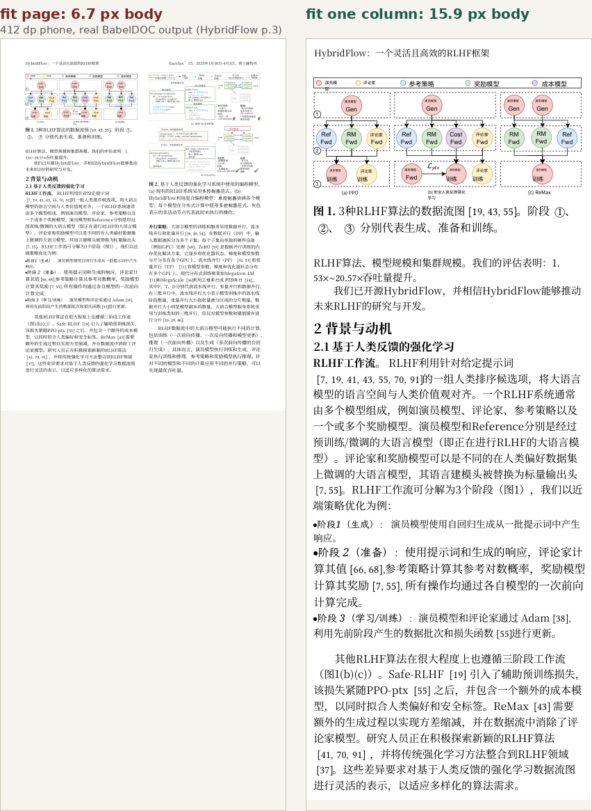

# 加一个安卓端会怎么样：可行性、代价与路线评估

> [!IMPORTANT]
> **目标设备与路线已更新（2026-11-20）**：移动端目标设备已从“6 寸手机（412dp）”明确变更为 **vivo Pad 5 Pro（13 寸、3096×2064、3:2、144Hz）**，并新增 **「左论文 + 右代码（Paper ↔ Code）」** 双栏阅读工作台需求。本页保留原手机评估基线作为历史参照，最新全量代码 Bug/架构审查、产品对标吸收与平板专属施工设计请见：**[vivo Pad 5 Pro 专属适配、全栈代码审查与「论文 + 代码」产品设计方案](VIVO_PAD5_PRO_REVIEW_AND_DESIGN.md)**。

评估日期 2026-11-20，基线提交 `6892fed`。本文只做评估，不改产品代码、不承诺未经测量的工期。
文中数字分三类：**实测**（本机脚本跑出来的，可复现）、**代码事实**（数出来的行数/接口/依赖）、**估算**（工程判断，不是承诺）。没有标注为实测的性能、兼容性、用户需求一律视为 `not_run`。

- 实测脚本：`scripts/eval_mobile_readability.py`、`scripts/eval_mobile_column_crop.py`、`scripts/eval_mobile_mockup.py`
- 实测数据：`artifacts/validation/m0-20261031T1005/mobile-readability.json`、`mobile-column-crop.json`
- 对比图：`docs/assets/android-reading-fit.png`
- 竞品调研（含来源链接）：[移动端竞品调研](MOBILE_COMPETITOR_RESEARCH_20261120.md)

---

## 0. 结论

1. **技术可行，但不是"移植"，而是"新增一个第二前端 + 一个移动阅读器"**：后端（Rust 7.1k 行、SQLite 库、检索、同步、AI 证据、批注）可以整块复用；前端（React 4.4k 行 + 675 行 CSS）几乎不能复用布局，只有交互逻辑和 pdf.js/KaTeX 这类渲染依赖能搬。
2. **手机端做不了翻译**，这是硬约束而不是取舍：整篇原位翻译依赖 BabelDOC 可执行文件（Windows 打包含 Python 运行时）。手机端只能是"译文的消费者"。这一点决定了架构必须是"瘦前端 + 共享后端/桌面"，而不是"两个对等端"。
3. **桌面端最强的两个卖点在手机上都失效**：双栏左右对照在 6 寸屏没有空间；"原位版面"在小屏等于"整页缩小"。实测：双栏论文整页适配 412dp 宽后正文只有 **6.7px**；改成单列裁剪后是 **15.9px**（可读）。所以手机端的主阅读形态必须是"单列裁剪"，最终形态是"重排/点段看译"，而不是缩小版桌面。
4. **建议现在不动手正式客户端**。先做两件桌面端本来就欠的账（R02 段落级译文映射、R08 同步协议文档化 + 阅读位置纳入同步），再用 2–4 周做"局域网 Web 阅读器"验证需求与体验；验证通过后，正式端推荐 **Kotlin + Compose + 复用 Rust core（JNI）**，而不是重写一套 Kotlin 后端，也不是 WebView 套壳。
5. **代价量级**：含桌面准备约 **8–10 人月**（P1–P5 合计 29–40 人周，再加 P0 的 4–6 周）。单人串行要做 8–10 个月；两人并行可压到 **4–5 个月**。同期桌面端 P0（R01–R05）至少推迟一个季度；如果两端并行且只有一份人力，更可能的结局是两端都停在"能演示、不能日用"。
6. **竞品给出的边界**（第 5 节）：小绿鲸到 2026 年仍没有手机原生 App，手机端是公众号 H5；Pad 版初代只做"划词 + 批注"（全文翻译是后来才补上的，手机 H5 端能力未说明），其官方 FAQ 还承认多端同读会覆盖批注。也就是说，"手机只读 + 局部翻译 + 可合并同步"不是我们能力不足的妥协，而是这个品类目前的真实边界；差异点应放在"本地可用 + 不丢批注"，而不是"手机也能整篇翻译"。

**一句话**：加安卓端不是"多一个壳"，是把产品从"桌面阅读器"变成"跨端阅读系统"，代价主要不在写 App，而在协议、数据模型和长期双端维护。

---

## 1. 如果现在就加，会发生什么

| 维度 | 具体后果 |
| --- | --- |
| 产品 | 多一个"通勤/床上读论文"的入口，这是本类产品真实的高频场景。但要清醒：小绿鲸这类头部产品到 2026 年也**没有手机原生 App**（只有 Pad 版 + 公众号 H5），说明"手机原生阅读器"在这个品类尚未被验证。我们要么成为第一个验证它的人，要么重复一次昂贵的试错。文案上应把手机端定位成"阅读伴侣"，而不是"手机也能翻译"。 |
| 工程 | 单仓变双前端 + 一套跨端协议。每次动 schema、同步文档、批注坐标，都要两端一起改一起验；桌面端迭代速度按经验下降三到四成。 |
| 交付 | 多一条发布链：签名、渠道（侧载/Play/国内商店）、隐私政策、AGPL 源码义务、崩溃与诊断。测试矩阵从"Windows 一种"变成"Windows + 多版本 Android + 多分辨率"。 |
| 人力 | 手机端不能只派一个人"顺手做"：阅读器手势、PDF 内存、后台任务、同步冲突都是专职工作量。 |
| 机会成本 | 桌面端现在还没到"日常可用"（R01 引擎安装、R02 翻译质量、R03 升级治理、R04 任务持久化、R05 万篇检索都还开着）。先做手机 = 把主线推迟一个季度以上。 |

---

## 2. 现状测绘（代码事实）

### 2.1 分层与体量

| 层 | 位置 | 体量（实测行数） | 手机端可复用性 |
| --- | --- | --- | --- |
| 原生核心 | `core/src/*.rs` | 7,089 行，58 个 `#[test]` | **高**：库、检索、同步、合并、批注、AI 证据都是纯 Rust + rusqlite，可交叉编译进 APK |
| 桌面外壳 | `app/electron/*.cjs` | 1,377 行，11 个文件 | **低**：窗口、对话框、safeStorage、子进程生命周期，全部要在 Android 重写 |
| 渲染层 UI | `app/src/*.tsx` | 4,366 行，含 Reader 904 / PdfPane 743 | **中低**：逻辑可搬，布局与交互范式（hover、Alt 拖拽、双栏、1100px 最小宽度）要重写 |
| 样式 | `app/src/styles.css` | 675 行 | **接近零**：固定 248px 侧栏，仅 1 条 `@media (max-width: 1180px)` 且不改结构 |
| 翻译引擎 | `core/src/engine.rs` + `scripts/prepare_babeldoc.py` | 外部 BabelDOC 进程 | **不可用**：见 3.1 |
| 同步传输 | `core/src/sync_transport.rs` | 调 rclone 子进程 | **不可用**：Android 无法执行可写目录里的二进制（见 3.5） |

### 2.2 三个耦合点（这是评估的关键）

**耦合点一：渲染层只有一扇门。** 整个 React 应用不 import 任何 Node 模块（`grep` 结果为空），只通过 `window.moonlight` 这一座桥访问数据（`app/src/api.ts:29`，桥定义在 `app/electron/preload.cjs`，暴露 16 个函数），下跌到 Rust 的 JSON-RPC 共 **72 个方法**。

> 含义：把这座桥从 IPC 换成 HTTP/WebSocket，前端组件逻辑就能在浏览器/WebView 里跑起来。这是"局域网 Web 阅读器"这条低成本路线的全部技术前提，也是第 4 节方案 A 成立的原因。

**耦合点二：能力全在子进程里。** `core/src` 里有 6 处 `Command::new`：BabelDOC 翻译、rclone 同步、PDF 元数据 worker（`current_exe --pdf-metadata-worker`）、Windows 的 `taskkill`/Unix 的 `sh` 取消。另有 `gag`（重定向 stdout）、`libc::setsid/prctl/killpg`。这些全部集中在 `engine.rs` / `sync_transport.rs` / `pdfmeta.rs` 三个文件里。

> 含义：把这三个模块按 `cfg(target_os = "android")` 切掉，`library` / `search` / `sync_model` / `ai` / `organization` 可以原样编进 APK。移植面是"外科手术"，不是重写。反过来，翻译和 rclone 同步这两个能力在手机上必须换实现或降级。

**耦合点三：布局是桌面专用的，不是响应式的。** 最小窗口 1100×700（`main.cjs:135`）、侧栏 248px 固定、双栏靠 flex 平分、选区用 `mouseup` + `Alt` 拖拽、段落悬停 90ms 触发。手机上没有 hover、没有 Alt、没有滚轮。

> 含义：所谓"复用现有前端"最多复用 30–40%（数据获取、状态管理、Markdown/KaTeX 渲染、pdf.js 封装思路），布局层等于新写。

### 2.3 跨端数据面

| 数据 | 现状 | 跨端时的问题 |
| --- | --- | --- |
| 论文/分类/标签/批注/笔记/AI 对话 | 每篇论文一份 JSON 文档，JSON Pointer 级三方合并（`core/src/sync_model.rs`） | 协议只有实现、没有规范文本；两份实现必然漂移 |
| PDF/译文/附件 | 按 SHA256 存不可变对象，随同步上传 | 手机上要按需下载；万篇库是几十 GB 量级 |
| 批注坐标 | **归一化到页面的 0–1 比例**（`PdfPane.tsx` 选区与框选都除以 `bounds.width/height`），页码 0 基 | 好消息：与 DPI、缩放无关，手机写入后桌面可直接对齐 |
| 阅读位置 | **只在本机 `localStorage`**（`Reader.tsx:41/152/324`），不进同步 | 手机端"继续上次阅读"今天拿不到数据，必须新增同步字段 |
| 译文 | 只存"译文 PDF 版本"（`versions.kind='translated'`），没有段落级译文表 | 手机端"重排/点段看译"缺少数据源，见 3.4 |
| 全文索引 / 文本块 | `blocks` 与 FTS 是本地派生缓存，**不同步**（`sync_model.rs:143` 明确不复制 FTS） | 手机要么自己解析建索引，要么问答只发"当前页/选区" |

---

## 3. 三条硬约束与两条体验约束

### 3.1 翻译引擎不可移动（硬）

`core/src/engine.rs` 用 `Command::new(babeldoc)` 起外部进程；`scripts/prepare_babeldoc.py` 打的是 Windows 自带 Python 的独立运行时。BabelDOC 依赖 PyMuPDF、字体、排版栈，体积和 ABI 都与 Android 不兼容（不是"编译一下"的量级）。

结论：

- 手机端**不能**发起整篇原位翻译，也不能安装/修复翻译引擎。
- 手机端能做的翻译是：① 展示桌面已生成的译文 PDF；② 划词/划句调用模型 API 做**局部文本翻译**（不需要版式引擎，只要有 key 和网络）。
- 因此"手机端 = 译文的消费者 + 局部翻译的调用者"。这条一旦想歪（比如计划在手机跑 BabelDOC），整个方案会崩。

### 3.2 屏幕：原位版面在小屏不成立（实测）

用真实语料和真实 BabelDOC 中文产物实测（`scripts/eval_mobile_readability.py`、`eval_mobile_column_crop.py`）：

| 文档 | 版式 | 正文中位字号 | 整页适配 412dp | 单列/文本框适配 412dp |
| --- | --- | --- | --- | --- |
| HybridFlow（中文译文） | 双栏，页 612×792pt，栏宽 249.8pt | 9.96pt | **6.7px**（不可读） | **15.9px**（单列裁剪，可读） |
| Attention（中文译文） | 单栏，文本框 398.9pt | 9.96pt | 6.7px | **10.0px**（偏小，需放大或重排） |

中文正文要舒适阅读大约需要 14–16px；6.7px 等于把论文缩成缩略图。手机上的可行形态只有三种：

1. **整页 + 双指放大平移**：能看清，但每读一行要横向拖动，是所有人都在骂的体验。
2. **单列裁剪 + 纵向滚动**：双栏论文直接受益（实测 15.9px，`hybridflow` 4/4 页都能自动识别栏边界）；单栏宽版论文仍然偏小。
3. **重排（文本流）**：体验最好，但需要结构化文本，见 3.4。



> 这张图是真实译文 PDF 渲染的，不是设计稿：左边是"整页适配 412dp"，右边是"裁一栏再适配"。同一页，字号差 2.4 倍。

### 3.3 索引与证据链在本地（硬）

Rust 的检索是 SQLite FTS5 + 中文二元切分 + 术语扩展（`core/src/search.rs`、`ai.rs`）。手机端没有同步过来的索引，也没有 OCR 结果缓存。

- 手机端要做全文搜索，得自己在设备上解析 PDF 建索引（pdf.js 抽文本 + 写 SQLite FTS），首篇冷建大约每页几十到数百毫秒（估算，未实测），万篇库不现实。
- 手机端要做"有出处的问答"，只能退化成"发送当前页/选区 + 页码"，或者把问题转发给桌面端检索。
- 好消息：手机上有 `blocks` 表结构可以直接复用，索引是"派生数据"，丢了可以重建，不涉及数据丢失风险。

### 3.4 重排不是"抽文本"（体验约束，实测）

拿 HybridFlow 第 3 页（译文 PDF）看抽取结果：**137 个文本块**，其中大量是图内标签的碎片——`演员模 型`、`未激活`、`评论家`、`Fwd`，坐标分散在整页宽度上。按 y 排序会横穿两栏和图注。

含义：**从译文 PDF 反推"可重排的段落流"不可靠**，必须做栏检测、图表区域排除、阅读顺序重建。体面做法只有两个：

- 在桌面端翻译/解析阶段就把**段落级原文与译文**（含 bbox 与顺序）落库——这正好是 R02 要做的"段落映射"；
- 或者手机端保持"页面"形态，不做重排。

这条是本次评估里最重要的连带结论：**手机端阅读体验的上限，被桌面端 R02 的进度锁死**。反过来说，先做 R02 不额外花钱，却让手机端从"能看"变成"好读"。

### 3.5 同步传输在 Android 上要换实现（硬）

桌面端同步 = 调 `rclone` 子进程（凭据走环境变量，HTTPS/WebDAV/S3 全由 rclone 负责）。Android 上：

- 应用可写目录里的可执行文件在 API 29+ 不能 `exec`（W^X），所以"把 rclone 塞进 filesDir 再跑"行不通；
- 可行变体：把 rclone 作为 `lib*.so` 放进 `jniLibs`，从 `nativeLibraryDir` 执行（能跑，但属于非常规打包，商店审核与 16KB 对齐等都要碰）；
- 或者在 Kotlin 里重写传输层：WebDAV（OkHttp + PROPFIND/MKCOL）+ S3 SigV4 签名 + 分片/重试。约 2–4k 行，且要覆盖七牛/OSS/坚果云三种方言。

无论哪条，**同步语义（提交格式、三方合并、冲突记录、outbox 重试）必须和桌面端逐字节一致**，否则两端会互相写坏数据。这就是为什么推荐共享 Rust core，而不是"Kotlin 再实现一遍"。

---

## 4. 四种做法

| 方案 | 做法 | 复用 | 首次可用 | 主要问题 |
| --- | --- | --- | --- | --- |
| **A. 局域网 Web 阅读器** | Rust core 加一层 HTTP，手机浏览器/轻壳打开；新写响应式阅读页 | 后端 100%，前端新建 | 2–4 周 | 离线弱、无系统集成、离开局域网不可用 |
| **B. Kotlin + Compose + Rust core(JNI)** | APK 内置核心，Compose 写原生 UI；同步走 Kotlin 或嵌入 rclone | 后端 ~70%，UI 全新 | 7–10 人月 | NDK 工具链、进程模块要切、同步传输要换 |
| **C. Capacitor/WebView 套壳** | 打包现有 React，桥接换成 HTTP/本地文件 | 逻辑 ~35%，布局重写、pdf.js 复用 | 3–4.5 人月 | WebView 大 PDF 内存与手势，后台任务不稳 |
| **D. 远程瘦客户端** | 手机只是桌面的"遥控器"，数据全在桌面 | 前端要新写，后端 0 改动 | 0.5–1 人月 | 桌面必须开机联网；无离线；不是产品形态 |

### 评分（1–5，越高越好）

| 维度 | A | B | C | D |
| --- | --- | --- | --- | --- |
| 移动阅读体验 | 3 | 5 | 3.5 | 4（限局域网） |
| 离线可用 | 2 | 5 | 2.5 | 1 |
| 首次可交付速度 | 5 | 2 | 3 | 5 |
| 长期维护成本（低=高分） | 4 | 4 | 3 | 5 |
| 与桌面端的架构一致性 | 3 | 5 | 3.5 | 1 |
| 风险可控性 | 4 | 3 | 2.5 | 4 |
| **合计** | **21** | **24** | **18** | **20** |

### 推荐组合

**A 做验证，B 做产品，C 和 D 只作为过渡/内部自用。**

理由：

- A 用 2–4 周就能回答"用户到底会不会在手机上读"这个最大的不确定性，且几乎全部代码（HTTP 层、移动阅读页的"单列裁剪"交互）都能被 B 复用，不是白做。
- B 之所以优于 C：把 Rust core 编进 APK 后，同步、合并、检索、批注语义只有一份实现，双端不会漂移；而 C 的 WebView 在 100MB PDF + 长列表 + 后台索引上是已知的弱项，且省下的时间会被"补 WebView 的坑"吃回去。
- D 只在"自用/临时"成立：它本质上不是安卓端，是把桌面投到手机上。

---

## 5. 对标：小绿鲸与同类产品

完整调研与来源见 [移动端竞品调研](MOBILE_COMPETITOR_RESEARCH_20261120.md)。这里只留影响本决策的部分。

### 5.1 一个反直觉的事实：小绿鲸没有手机原生 App

| 平台 | 状态 | 依据 |
| --- | --- | --- |
| Web / Windows / macOS / 鸿蒙 | 有 | 官网[发展历程](https://www.xljsci.com/about/) |
| Android / iPad 平板 | 2023-11 上线，官方下载页标题就是"安卓 Pad 版" | [下载页](https://www.xljsci.com/download/android) |
| 手机原生 App | **没有**；手机走微信公众号 H5 | 官方 [FAQ 4.2](https://www.xljsci.com/faq/) |
| App Store | 条目兼容 iPhone，但明确标注"此版本为 Pad 版" | [App Store](https://apps.apple.com/cn/app/id6450911529) |

> 含义：这个品类最头部的产品都没做真正的手机原生阅读器，手机上用 H5 兜底。所以"仿照小绿鲸做安卓端"实际上**没有现成的原生范式可抄**——能抄的是它的功能取舍，不是它的实现。我们要做的是一件此品类尚无人验证过的事，这既说明空间存在，也说明风险真实（见第 1 节、第 9 节 R6）。

### 5.2 它砍了什么（官方自述）

2023-11 官方发布文承认："起初希望将 PC 端所有功能复制到平板端，然而现实很骨感……不得不做出取舍，初代 Pad 版保留基础核心功能。" 具体：初代只有划词翻译 + 批注，手写与全文翻译列为后续目标；初期 Pad 端不能导入文献（须先在 PC/网页导入）；不进华为、小米商店；7 人团队做了 200 多天。

计费与硬限制（[订阅协议](https://www.xljsci.com/sla/)）：全文翻译 30 次/月（鲸会员）/ 50 次/月（AI 会员），单篇 ≤200 页、仅英译中；加密件、扫描件不能译；不支持图片/表格翻译；截图翻译 300/500 次/月；网盘按容量收费。

口径校正：现版本 Pad 端商店文案已含"全文对照翻译：1:1 还原原文排版"，即初代砍掉的能力后来补上了；但**手机（公众号 H5）是否支持全文翻译，官方未说明**，第三方教程（2026-06）称"全文翻译只支持 PC，手机平板暂不能用"，该说法可能已过时——列为不确定项，不作为本评估的论据。

### 5.3 它的差评就是我们的需求清单

iPad 版 App Store **2.7/5（444 评分）**，差评高度集中在四件基础设施：

| 差评 | 本质 | 我们的对策 |
| --- | --- | --- |
| "切后台再进来，文献已经被关闭了" | 阅读态没有持久化 | 阅读位置三元组入同步（6.5） |
| "为什么一定要做成符合页面大小" | 缩放被锁死在 fit-page | 页模式自由缩放 + 单列模式（6.4） |
| "横屏翻译在右边，左边看不了多少" | 分栏在窄屏挤压原文 | 不做双栏对照；段后/浮层译文 |
| "左右两列内容连在一起选择" | 双栏选区串栏 | 选区按栏裁剪 + 手柄可拖 |

（另有手写丢笔画、不能撤销、闪退。）第 8 节的验收门槛已经把前四条写成硬指标——这不是我们想多了，是别人踩过的坑。

### 5.4 移动端阅读形态的三个流派

| 流派 | 代表 | 做法 | 代价 |
| --- | --- | --- | --- |
| 原版 + 分栏/浮层译文 | 小绿鲸 | 1:1 保留版面 | 窄屏挤压、缩放受限——差评主要来源 |
| 单栏重排 + 逐段对照 | Scholaread（靠岸） | 双栏重排成单列，段后接译文 | 不再是原版面，公式图表另做 |
| 阅读模式重渲染 | 秘塔 | 重新排版渲染 | 版式与图表位置丢失 |

小绿鲸是三家唯一坚持原版的，也因此吃下最多阅读体验差评。这与 3.2 的实测结论一致：**默认"单列 + 段后/浮层译文"，原版页面降级为"核对模式"**。

### 5.5 同步：全行业都靠"最后写入覆盖"

- 小绿鲸官方 FAQ 明说：多端可同时登录，但"不建议同时进行文献阅读，会造成笔记/批注被覆盖不能保存"，只提供事后"备注恢复"——即 last-write-wins，没有合并。
- Zotero 官方移动端同步库、笔记、PDF 批注，但官方功能表没提阅读进度。
- Readwise Reader 的教训：刷新文章等于删除重存，批注一起丢——**文档身份必须稳定**。

我们的 JSON Pointer 三方合并 + 冲突记录在这个品类里是差异化能力，不要为了"和小绿鲸保持一致"退回覆盖式同步。反过来，它也是 Android 端最值得讲的卖点：单机可用、不丢批注。

### 5.6 可抄 / 不该抄

| 可抄 | 不该抄 |
| --- | --- |
| 长按选区 → 浮动工具条（翻译/高亮/笔记/复制） | 纯云端库、不碰本地文件（与本地优先冲突） |
| AI 助手放侧边栏/底部抽屉，不占正文 | 手写优先的批注（工程量大、评价方差大） |
| 笔记模板 + 大纲/导图切换 | 按"翻译次数"计费的产品结构 |
| 截图翻译（对应我们的框选批注） | 双栏横屏对照（窄屏必败） |
| 题录自动补全、影响因子/分区展示 | 10000+ 引文格式、完整文献管理 |

---

## 6. 功能取舍

按"本地优先 + 手机不做整篇翻译"这个前提，且参考 5.3 的反向清单，取舍如下。

### 6.1 手机端必须有（缺了就不成立）

| 功能 | 说明 | 依赖 |
| --- | --- | --- |
| 文献列表 + 搜索 | 标题/作者/标签/目录；全文搜索可选 | 复用 Rust `search`/`list_papers_page` |
| 继续上次阅读 | 跨端恢复到页 + 页内位置 | **需新增同步字段**（今天在 localStorage） |
| 原文/译文切换 | 已下载的译文 PDF，页数一致 | 复用版本模型 |
| 单列裁剪阅读 | 双栏自动识别、按栏纵向滚动、左右滑换栏 | 新写（实测可行） |
| 划词翻译 / 解释 | 局部调用模型 API，带原文引用 | 需手机端独立 key（Keystore） |
| 高亮 + 评论 + 速记 | 与桌面同一套归一化坐标 | 复用批注模型 |
| AI 对话（页/选区上下文） | 不做整篇 RAG，或整篇交给桌面 | 复用 `ai` 提示词；检索降级 |
| 同步（增量、可恢复） | 增量提交 + 冲突展示 | 复用 `sync_model` + 新传输层 |

### 6.2 应该做但不阻塞首版

- 离线标记（"保存到手机"）+ 存储管理；
- 阅读列表/稍后读；
- 表格/公式区域截图提问（桌面已有框选批注的坐标基础）；
- 手机端建标签/分类（写同步文档）。

### 6.3 明确不要做

| 不做 | 原因 |
| --- | --- |
| 手机端发起整篇原位翻译 | 引擎不在手机上，见 3.1 |
| 安装/修复 BabelDOC、配置翻译引擎 | 同上，属桌面职责 |
| Zotero 迁移、备份/恢复 | 一次性重操作，桌面更合适，且涉及大量文件 |
| 手机端配置云同步凭据 | 应沿用桌面已保存的配置，或用配对/二维码传递，不要手输 AK/SK |
| 万篇库全量同步到手机 | 存储与流量都不现实，改为按需下载 |
| 双栏左右对照 | 6 寸屏没有空间，强行做等于把两个 3px 字号的栏放一起 |

### 6.4 手机阅读器的三种模式（建议一起设计，分期上线）

1. **页模式**：整页 + 双指缩放 + 平移。作为兜底，任何 PDF 都能看。
2. **单列模式**：检测栏边界，裁一栏适配宽度，纵向滚动，左右滑换栏。实测能把 6.7px 提到 15.9px，是 MVP 的主力。
3. **流式模式**：按段落流重排，公式/图表以裁切图占位，点段落显示原文与译文对照。体验最好，但**依赖 R02 的段落级映射**，放第二期。

### 6.5 跨端要补的四件事（桌面端也要改）

| 要补的 | 现状 | 改动 |
| --- | --- | --- |
| 阅读位置 | localStorage | 入同步文档（新字段 + schema 兼容） |
| 段落级译文 | 只有译文 PDF | R02 落地时顺带解决，手机端直接受益 |
| 同步协议文档 | 只有 Rust 实现 | 抽成 `docs/SYNC_PROTOCOL.md` + 黄金样本（golden fixtures） |
| 冲突的移动端呈现 | 桌面有冲突列表 | 手机端要有"保留本地/保留云端"的轻量选择，不能静默丢数据 |

### 6.6 首版三屏信息架构

| 屏 | 主要控件 | 关键行为 |
| --- | --- | --- |
| 文献库 | 搜索、最近/收藏/文件夹、每篇的"已下载/已翻译"标记 | 单击进阅读；长按多选，只提供"下载/移出离线"，不做批量管理 |
| 阅读 | 返回、标题、页模式/单列模式、原文/译文、页码、目录 | 长按选区 → 浮动工具条（翻译/解释/高亮/笔记/复制）；左右滑换栏；AI 为底部抽屉 |
| 抽屉 | AI 对话 / 笔记 / 批注 三个 Tab | 上下文 = 选区 + 页码 + 论文；流式输出；结果可一键存为笔记 |

### 6.7 单列裁剪的实现要点（可行性已实测，工程仍需真机验证）

- **栏边界**：取当前页文本块的 x 直方图，在页面中线附近找最宽的空白带作为 gutter。实测 HybridFlow 4/4 页命中；Attention 这种单栏论文正确地"不切"（走文本宽度适配）。
- **通栏元素**：跨 gutter 的块（跨栏公式、宽图、宽表）所在的行区域必须切回整页宽度或允许横向滚动，不能裁掉——这是"半截公式"事故的主要来源。
- **状态**：记住每页的栏号，翻页回到第 1 栏；阅读位置记为 `(页, 栏, 栏内偏移)`，这个三元组顺便就是 6.5 要入同步的字段。

---

## 7. 工作量与排期（估算，非承诺）

假设一名熟悉 Android 与 Rust 的工程师，或两名（Android + Rust）并行。

| 阶段 | 内容 | 人周（单人） | 产物 | 通过条件 |
| --- | --- | --- | --- | --- |
| P0 桌面准备 | 段落映射落库、阅读位置入同步、协议文档化、schema 兼容检查 | 4–6 | 数据与协议就绪 | 双端可以对着同一份文档验收 |
| P1 Phase 0 验证 | 局域网 Web 阅读器：列表 + 单列阅读 + 批注 | 6–8 | 可用的验证版 | 三个 Gate（第 8 节 1–3 条）全过 |
| P2 客户端骨架 | Rust core 上 Android、SQLite、Keystore、后台服务、数据目录 | 4–6 | 能打开本地库的 APK | 冷启动 ≤3s，58 个 Rust 测试在设备上通过 |
| P3 同步 | 传输层（WebDAV/S3）+ 提交/合并 + 冲突 UI | 6–8 | 双端往返 | 黄金样本逐字节一致 |
| P4 阅读器 | 页/单列两模式、选区、批注、速记、AI 面板、搜索 | 10–14 | 日常可读 | 20 篇真实论文全流程 |
| P5 发布 | 签名、渠道、崩溃与诊断、隐私政策、AGPL 源码 | 3–4 | 可分发包 | 干净设备安装即用 |

合计 P1–P5 为 **29–40 人周**，加上 P0 的 4–6 周是 **33–46 人周 ≈ 8–10.5 人月**。单人串行 8–10 个月；两人并行（P2 与 P3 并行，P4 依赖 P2，P5 提前准备签名与合规）约 **4–5 个月**。

校准参照：小绿鲸官方自述其 Pad 初代（只做划词翻译 + 批注、不能导入文献）由 7 人团队做了 200 多天。我们的 P1–P4 覆盖面比它初代更大（还要同步、离线、本地库），因此"两人 4–5 个月"仍只是工程估算的下沿，不是中位数；且它假设两人都全职、都不被桌面端 P0 打断。

> 这个区间比"凭感觉"宽的诚实原因是：P2 的工具链风险（`ring`/`rustls`、`libsqlite3-sys` 在 NDK 下的交叉编译）和 P3 的三种云方言是典型的"要么两天过、要么两周卡"的项。**必须先用 2–3 天做 P2 的构建 spike 才能收窄这个数**。

### 与现有路线的关系

- **不建议在 R01–R05 关闭前启动 P2**。桌面端现在的问题（引擎安装、翻译质量、升级治理、任务持久化、万篇检索）会直接变成手机端的问题，而且更难查。
- 如果一定要并行，只做 A（局域网阅读器）：它不动数据模型，风险最低，且能提前回答产品问题。
- R02（段落映射）与 P0 桌面准备是同一件事的两个说法——先做 R02，手机端的"流式模式"才有数据；不做 R02，手机端只能停在"单列裁剪"。

---

## 8. 验收门槛（可证伪，未通过不算完成）

1. **阅读可读性**：412dp 宽、双栏论文，单列裁剪后正文 ≥15px，纵向滚动即可读完一页，无横向拖动。基准：实测 15.9px。
2. **滚动性能**：连续滚动 10 秒 ≥50fps（目标 55fps），在中端机（非旗舰）上测。
3. **冷启动**：进程冷启动到列表可用 ≤3s；打开 20 页已下载 PDF 到可读 ≤2s。
4. **内存**：100MB PDF 峰值 <600MB，不触发 OOM；返回列表后释放。
5. **离线**：飞行模式下可读、可批注、可看历史对话；联网后增量同步成功，不重复上传。
6. **批注互操作**：手机新建高亮 → 桌面同页同位置；桌面改评论 → 手机可见；冲突保留两端且可手动选择。
7. **译文一致性**：桌面已翻译的 20 篇，手机 100% 能切原文/译文，页数一致，批注不串版本。
8. **数据安全**：schema 版本不匹配时拒绝写入；API key 只落 Keystore/EncryptedSharedPreferences；日志无 key、无正文。

---

## 9. 风险登记

| # | 风险 | 触发 | 影响 | 缓解 | 验证方式 |
| --- | --- | --- | --- | --- | --- |
| R1 | 双端协议漂移 | 两份实现（Rust + Kotlin） | 数据损坏、同步冲突爆炸 | 共享 Rust core；或抽协议文档 + golden fixtures | 黄金样本双端跑同一组用例 |
| R2 | NDK 交叉编译失败 | `ring`/`libsqlite3-sys` 在 aarch64 下 | P2 延期数周 | 2–3 天 spike 先证伪；失败则退回方案 C | 设备上跑通 58 个测试 |
| R3 | rclone 不可执行 | API 29+ W^X | 同步功能缺失 | 放 `jniLibs` 执行；或 Kotlin 重写传输层 | 三种云各做一次往返 |
| R4 | WebView 方案内存/手势 | 方案 C | 体验不达标返工 | 优先方案 B；C 只做原型 | 100MB PDF 压测 |
| R5 | 分发与合规 | 上架、AGPL、隐私 | 无法分发 | 先侧载；APK 随源码提供；商店后置 | 干净设备安装 |
| R6 | 伪需求 | 用户其实不在手机读公式 | 白做 8–10 人月 | Phase 0 用真实用户试用 2 周 | 使用频次与留存 |
| R7 | 拖慢桌面主线 | 一份人力拆两半 | 两端都不能日用 | 排期硬隔离，先桌面 P0 | 里程碑对比 |
| R8 | 手机存储 | 万篇库数十 GB | 装不下 | 按需下载 + 离线标记 + 存储上限 | 500 篇库实测 |
| R9 | 凭据同步 | 试图同步 API key | 安全事件 | 凭据永不进同步文档 | 抓包与日志审计 |

---

## 10. 如果下一轮就要动手，建议这样做

1. **先关 R02（段落级映射）**：它是手机端"流式阅读"的唯一前置，桌面端自己也欠这笔账。做完这一项，手机端从"单列裁剪"升级到"点段看译"就不需要额外数据工作了。
2. **两周内写 `docs/SYNC_PROTOCOL.md`**：把 `sync_model.rs` 的文档结构、提交格式、合并规则、冲突语义、路径白名单抽成文字 + 10 条黄金样本（新增/编辑/删除/冲突/附件/大小写/中文键）。没有这份东西，任何第二客户端都不该开工。
3. **做 P1 的局域网阅读器，找 3–5 个真实用户用两周**：记录每天打开次数、单次阅读时长、放弃点（是"字太小"还是"没有译文"还是"找不到论文"）。这是唯一能回答 R6 的办法，成本 6–8 人周，且代码可被正式端复用。
4. **投 B 之前先花 2–3 天做 NDK 构建 spike**：目标只有一个——`moonlight-core` 能在 aarch64 上编出来并跑通现有 Rust 测试。过不了就退回方案 C，不要在工具链上赌两周。
5. **如果试用结果显示需求弱**（日均打开 <1 次、留存 <30%），把预算放回桌面端的 R10（阅读器补齐）与 R12（元数据/去重），收益确定得多，且不会增加双端维护成本。

---

## 11. 附录

### 11.1 复现实测

```bash
.venv/bin/python scripts/eval_mobile_readability.py      # 整页适配后的字号
.venv/bin/python scripts/eval_mobile_column_crop.py      # 单列裁剪后的字号与栏检测
.venv/bin/python scripts/eval_mobile_mockup.py           # 生成 docs/assets/android-reading-fit.png
```

### 11.2 扫描过的代码位置

- 桥与 IPC：`app/electron/preload.cjs`、`app/electron/main.cjs`、`app/src/api.ts`
- 桌面布局与交互：`app/src/styles.css`、`app/src/Reader.tsx`、`app/src/PdfPane.tsx`
- 数据与协议：`core/src/main.rs`（72 个 RPC）、`core/src/library.rs`、`core/src/sync_model.rs`、`core/src/sync.rs`
- 不可移植能力：`core/src/engine.rs`（BabelDOC）、`core/src/sync_transport.rs`（rclone）、`core/src/pdfmeta.rs`（worker 进程）、`app/src/ocr.ts`（tesseract.js，手机建议换 ML Kit）

### 11.3 本次未验证（`not_run`）

- Android 设备上的任何性能、内存、帧率；
- Rust core 的 aarch64 交叉编译（本机无 NDK/JDK，未装 target）；
- WebView/Capacitor 下的 pdf.js 表现；
- 任何真实用户对手机端阅读的接受度；
- 三种云存储在 Kotlin 客户端下的兼容性。
