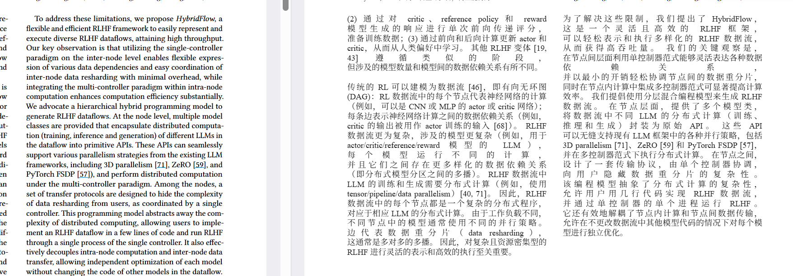
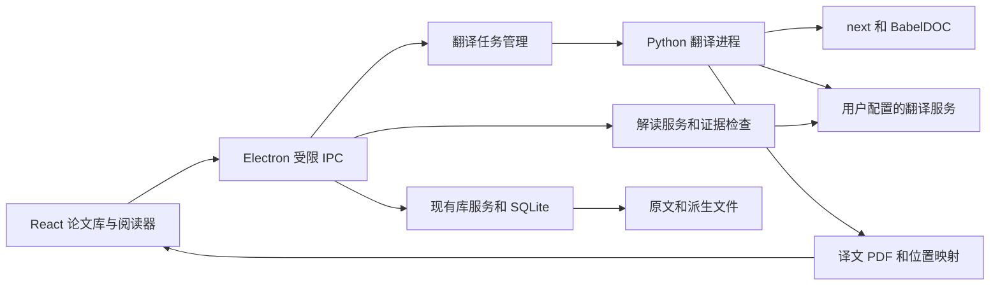

# 本地论文管理与原位翻译设计

设计日期为 2026 年 10 月 31 日。执行者为 DS。目标是一个 Zotero 式独立桌面论文库，翻译、解释、批注与原文阅读共享位置和文档上下文。第一优先级是用户参考图中的双栏与段落区域保留效果。

本方案中的架构、阶段和指标属于拟实施要求。上游现有能力列在对应来源旁；真实运行结论由 [验证计划](VALIDATION.md) 产生。

## 产品范围

首版面向含可提取文本的英文科研 PDF，目标语言为简体中文。默认本地保存论文、元数据、批注、译文、术语表和对话。云同步、浏览器采集扩展、Word 插件、跨库知识图谱、扫描件全文翻译和移动端放入后续版本。

“Zotero 式管理”在首版具体指：本地 PDF 批量导入，元数据编辑，分类与标签，标题/作者/DOI/已索引正文检索，阅读状态、星标，文件与版本去重，回收站，BibTeX 和 RIS 导出。正文索引尚未完成的文档明确显示状态。Word 插入引用、CSL 全样式兼容和 Zotero 双向同步不属于首版已承诺能力。

“原位翻译”以页、栏、段落区域为约束。保留原页尺寸、旋转和页序；中文段落在对应区域内重新排版。段内允许换行差异和合理字号调整。图片、表格结构和独立公式保留；图内嵌字、复杂表格单元格翻译作为独立能力标记。无法安全放回的段落显示原文及原因，可打开浮层查看译文。

参考截图是视觉目标，不是准确率、耗时或位置误差的测量数据。HybridFlow 的其他 PDF 版本可以验证同类排版，但不声称与截图来源完全相同。

## 开源复用决策

| 层次 | 首选 | 复用内容 | 验证关口 |
| --- | --- | --- | --- |
| 桌面与论文库 | PaperQuay fork | Electron、React、SQLite、本地论文库、分类、笔记、已有导入流程 | 在干净环境按锁文件构建，验证读写和备份；原文阅读不依赖在线解析 |
| PDF 显示 | 底座已有 PDF.js 路线 | 原文、译文的分页渲染、文本选择、缩放 | 同页切换、字体、文字层、旋转及选区可用 |
| 翻译入口 | PDFMathTranslate-next 本地适配器 | 服务配置、进度、取消、译文 PDF 输出 | 固定依赖后完成真实论文翻译与错误处理 |
| PDF 翻译内核 | 与入口兼容的 BabelDOC | 结构解析、公式处理、正文翻译、排版 | 版面、覆盖率与语义验收 |
| 解释与问答 | 统一模型适配层 | 用户提供的兼容服务、局部/章节上下文 | 来源可跳转，证据与回答人工核对 |

PaperQuay 已提供本地论文库、PDF 阅读、MinerU 文本块翻译和笔记工作流。现有文本块译文可保留为可选阅读方式；主阅读模式新增保留版面译文 PDF。[固定提交的项目说明](https://github.com/WangQrkkk/PaperQuay/blob/1d65fdbfe0eb7ef33c57cf8b9d87b6afdb5f06bf/README.md)

PDFMathTranslate-next 的 `do_translate_async_stream` 提供进度、结束和错误事件；结束结果含输出 PDF 路径。这一接口没有承诺生产可用的段落坐标流。[API 文档](https://pdf2zh-next.com/advanced/API/python.html)、[固定提交的入口源码](https://github.com/PDFMathTranslate-next/PDFMathTranslate-next/blob/f8dffcf4c3a33b254391d43514439b975ce8d966/pdf2zh_next/high_level.py)

当前核对的 next 版本为 2.9.0，其依赖约束为 `babeldoc>=0.6.2,<0.7.0`。初始候选使用 Python 3.12、BabelDOC 0.6.2；DS 安装后锁定完整依赖和包哈希，并核查该组合的实际代码。不能用 BabelDOC 当前 main 的行为推定 0.6.2 的能力。BabelDOC 官方将自身 Python API 视为内部接口，并推荐通过 next 接入。[依赖清单](https://github.com/PDFMathTranslate-next/PDFMathTranslate-next/blob/f8dffcf4c3a33b254391d43514439b975ce8d966/pyproject.toml)、[BabelDOC 接入说明](https://github.com/funstory-ai/BabelDOC#python-api)

当前阶段暂不进行版权与许可证审查，也不以此限制技术候选或阻塞原型验证。来源记录中的许可字段仅保留调研事实。NeoRead 纳入源码复用与原位译文导出候选，按实际排版效果、位置映射能力、稳定性和改动面比较。

底座备用路线：如果 M1 无法建立可维护基线，先比较 NeoRead 作为整体底座或复用其相关模块的修改量；仍不合适时采用 Electron + React + SQLite + PDF.js 的最小桌面应用。保持本设计的文档版本、任务与位置协议，先实现同一组核心流程。各路线先独立验证，再选择一个底座，避免同时维护两套论文库。记录切换路线的具体原因与证据。

## 阅读工作流

用户导入论文后立即能读原文。后台计算文件哈希、提取可用元数据和文本索引；信息缺失不阻止收录。首次翻译由用户触发，可选当前页、页范围或全文。任务状态与当前论文绑定，切到其他论文不会丢失任务。

阅读器主工具栏包含原文、译文、左右对照、页码、缩放和翻译状态。左右对照显示两份同尺寸分页 PDF；默认使用单独的译文 PDF 与原文，不依赖拼接双语 PDF 的页编号。拼接双语 PDF 作为导出形式单独维护页映射。

切换模式时保留原文锚点，包括原页索引、段落和页面内位置。左右滚动以当前可见原页和段落为依据，程序触发的同步不反向循环；手动滚动或缩放可中断自动定位。对暂未生成译文的页继续显示原文及状态。

选中文字出现翻译、解释、提问、高亮和笔记操作。右侧面板展示结果与证据；没有选择时支持当前页或章节摘要。解释和译文分栏保存，正文中不混入模型的推测和附加解释。

原文、译文和批注均归入同一个论文条目。导出可选原文、译文、双语 PDF、批注摘要、BibTeX/RIS；批注写入 PDF 是独立导出动作，不修改库里的原始文件。

## 本地架构

Electron 主进程持有本地文件和数据库权限。renderer 开启隔离和 sandbox，关闭 Node 集成；通过明确定义的 preload 操作访问数据，按文档 ID 解析文件，拒绝任意路径读写。模型回复按不可信文本渲染，不执行 HTML、脚本或系统工具。

Python sidecar 优先通过 stdin/stdout 的 JSONL 控制协议通信，stderr 用于日志，避免为首版暴露 HTTP 服务。若底座已有可靠本机服务，可复用其认证和生命周期，但不得同时创建两套任务系统。每个事件有协议版本、requestId、jobId、递增序号和类型；JSONL 保证一条完整 JSON 占一行。PDF、图片和长文本不放入事件中，只返回应用已授权的派生文件 ID。

任务启动后先报告 `ready` 与能力。主进程处理启动超时、进程退出、管道截断、取消确认和孤儿进程回收。取消传播到 next 的异步任务及其子进程；先协作取消，超过期限后终止该任务的进程树。不得让已取消任务发布成功结果。

API Key 只在主进程/后端使用，优先写入操作系统凭据存储；无法安全持久化时使用会话凭据。renderer、命令行参数、报告和日志不包含密钥。请求的服务、内容范围与模型配置在设置里可见。

## 翻译与渲染链路

### 首条验证链路

M0 先跑通完整文档的翻译 PDF，再在测试阅读器中加载。确认页数、几何信息、可复制文字层、图表与公式后才接论文库。这一步可先使用 next 的公开入口，不要求改造引擎。

模型固定为一个用户可用的服务和模型 ID，翻译与解读可分别配置。首轮不同时比较多个引擎与多个模型。基线效果不佳时固定其他条件，单独更换模型或引擎版本，保存对比。

### 保留段落区域

优先复用引擎的公式、字体、原始对象保留和排版机制。不要把整篇论文转成一栏 HTML 后当成原位译文交付。增加术语表、必要上下文和翻译提示词版本；术语纠正后可以重新翻译选定范围。

每个区域标记 `translated`、`retained_source`、`unsupported` 或 `failed`，并附原因。页面含回退时提示具体数量。排版先尝试段落区域内换行、合理行距和有限字号调整；仍溢出时保留原文，译文进入可展开面板，不裁切、不盖图、不无限缩小。

独立公式和科研图形尽量保留原有对象。行内公式采用引擎的保护与恢复策略，并验证符号和上下标。图中不可提取的字、表格结构复杂的区域先保留原样。扫描页、缺失字符映射、密码 PDF 和解析失败按能力显式提示。

### 逐页可读与全文导出

公开入口返回最终 PDF，不预设实时段落回调。M1 允许“原文立即可读，全文任务完成后切换译文”。M2 再实现当前页优先和相邻页预取，作为独立性能目标。

页范围任务必须实测 `pages`、未选页保留与输出页编号行为。适配层维护原页到输出页的显式映射；不能将范围任务的第 1 页直接当成原文第 1 页。需要逐页发布时生成完整临时 PDF，再原子发布单页片段或完整版本；不得读取仍在写入的 PDF。

按页解析可能截断跨页段落，前后文和术语抽取应按文档缓存。是否与全文翻译一致作为实验结果记录。优先级调度器限制并发，当前页优先于后台全文；同一缓存键的请求合并，避免重复计费。

## 原文与译文对应关系

坐标统一为原文页旋转校正后的 CropBox 局部坐标，单位 PDF point；记录宽、高、原始 box、旋转矩阵及逆矩阵。坐标原点取可视页左上角。引擎、PDF.js、OCR 或布局模型的坐标在边界一次性转换，不能混用像素与 point。

以 `sourceVersionId + parseRevision + pageIndex + blockId` 定位原文。`blockId` 在一个解析版本内稳定，重新解析产生新版本。文本哈希用于核对内容，不单独用作 ID，因为相同文本可能重复出现。每个段落可有多个选区矩形，支持跨栏或跨页续段关系。

译文映射允许多对多：一个原文段落对应多个译文区域，或若干原文句子共同对应一个译句。映射带粒度、方法和置信状态。M2 必须实现段落级映射；句子级只有在源文本覆盖和坐标检查通过后启用，失配时退回段落并标明粒度。

优先在解析、翻译和排版阶段保存原文结构、译文文本及输出坐标，导出自有 manifest。BabelDOC 内部 hook 固定在经过 M0 的兼容版本上，由薄适配器承担；调试输出可用于调查，不能成为产品运行依赖。只有先后快照通过测试才能关联，不能假定内部调试编号永不变化。

如无法在可控修改面内导出映射，M1 使用页级同步；M2 先评估引擎适配，再评估成品 PDF 的文本、几何与语义对齐。后者必须设置低置信拒绝，不将相似度最高的候选无条件绑定。完整原生交互交付仍要求通过段落级验收。

## 数据模型与缓存

复用底座已有实体与迁移机制，以下为逻辑模型，不要求创建第二套重复论文库。

| 实体 | 关键字段和约束 |
| --- | --- |
| Paper | 内部 ID、标题、作者、年份、DOI/arXiv、分类、标签、阅读状态、删除标记 |
| SourceVersion | Paper ID、文件 SHA256、不可变文件 ID、页几何、导入来源；不同 PDF 版本保留 |
| ParseRevision | SourceVersion ID、解析器及版本、结构参数哈希、坐标协议版本 |
| SourceBlock | ParseRevision ID、blockId、类型、原页、矩形列表、阅读顺序、原文、文本哈希 |
| TranslationRun | 原文与解析版本、语言、服务与模型、提示词/术语表哈希、引擎版本、任务配置 |
| TranslationBlock | Run ID、源块集合、译文、译文页与矩形、状态、回退原因、对齐方法 |
| Annotation | 不可变 ID、原文锚点、可选译文版本与字符范围、摘录、颜色、评论 |
| Conversation | Paper ID、输入选区、实际上下文范围、模型、消息及证据锚点 |
| Job | 配置哈希、任务状态、阶段、事件序号、输出暂存位置、错误、重试记录 |

缓存键至少包含源文件哈希、解析/引擎版本、目标语言、模型配置、提示词、术语表和排版参数；任何影响输出的选项都必须进入键。记录服务 ID 和显式模型 ID；服务端同名模型可能更新，提供强制重译及时间记录。术语表变化先使相关缓存过期，旧译文继续可读，任务成功后才切换。

原文批注锚点保持不变；译文修改或重译后校验译文引用，不能按旧字符偏移静默贴到新句子上。重新解析的旧锚点先保留，迁移成功后关联，否则显示待重新定位。用户编辑的译文保留独立修订，后台任务不得直接覆盖。

同 SHA256 文件导入为幂等操作；同 DOI 的不同文件进入版本核对，不自动丢弃。删除正在翻译的论文先取消并阻止迟到结果发布，进入回收站；恢复不自动启动付费任务。文件按引用计数或受管所有权删除，不删除用户链接的外部原件。

数据库写入和产物发布采用可恢复提交：先在暂存区完整写文件、校验与原子改名，再以事务登记可见版本；中途失败允许清理孤立暂存文件或重新登记，不能显示不存在的文件。备份同时包含数据库一致快照与引用文件清单。

## 任务状态与解读

任务流为 `queued → preparing → parsing → translating → typesetting → validating → completed`。任一非终态可转为 `cancelling → cancelled` 或 `failed`；引擎无法报告的阶段不伪造百分比。存在回退区域时标记 `completed_with_fallbacks`，并给出翻译覆盖率。

暂停若不能由引擎直接支持，就实现为“保存已发布产物后取消，恢复时复用缓存重新调度”，不可伪装成原进程原地继续。重启把中断任务标为可恢复，用户已授权的范围可继续，不能扩大页范围或更换付费服务。每个发布操作核对 jobId、运行版本和取消标记。

解读请求按选句、当前页、章节或全文明确上下文范围。全文超过模型容量时分段检索或分层摘要，并在结果里说明实际依据，不能将当前页摘要标成整篇摘要。首版不强制引入向量数据库，可先按页、章节和全文词法索引取证据。

回答用结构化证据引用已存在的 SourceBlock 和 SourceVersion。输出校验拒绝不存在的 ID，点击证据跳到原文并高亮；这只能保证可定位，结论是否被证据支持仍需语义验收。数字、否定关系、实验设置、贡献和局限是人工检查重点。解释公式时引用原公式及附近定义；图表问题可显式发送对应图和图注，不从没有证据的图片内容编造数值。

## 实施阶段

| 阶段 | 实现范围 | 完成依据 |
| --- | --- | --- |
| M0 翻译验证 | 固定样本、依赖和模型，真实译文、渲染与质量报告 | 验证计划中的核心版面与语义关口通过 |
| M1 桌面集成 | 底座构建、论文管理回归、sidecar、页级同步、输出版本 | 真实原文与译文在同一个论文条目中可读可恢复 |
| M2 原生对照 | 段落映射、双向定位、批注、逐页调度实验 | 对齐与持久化测试通过，回退和粒度可见 |
| M3 原生解读 | 划句解释、摘要、问答、证据跳转 | 有证据/无证据问题均满足验收 |
| M4 交付 | 故障恢复、备份、离线阅读、打包 | 当前平台安装包和完整流程实测 |

阶段失败时保留证据、修复并重测受影响部分。预计工作量在 M0/M1 的实际结果后重新估算，本设计不承诺未经测量的耗时或与 Moonlight 等同的翻译质量。
